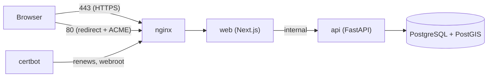

# Deployment

One script takes a raw Linux server to a running Cropshift at `https://your-domain/`: it installs Docker, asks for each setting, builds the images, starts the stack behind nginx and gets a Let's Encrypt certificate that renews itself.

```bash
git clone https://github.com/jose-fernando-1/Rurotation.git
cd Rurotation
sudo ./deployment/install.sh
```

Before you start you need:

- A server running Debian or Ubuntu (the tested path) or a Fedora/RHEL-family distribution (best effort), with root access, about 2 GB of RAM (or swap) and 6 GB of free disk.
- A domain with an **A record pointing to the server's public IP**.
- Ports **80 and 443** open to the internet (the installer can open them in `ufw` or `firewalld`).

It is safe to run again: it keeps your answers, the database and the certificate, and only fixes what is missing.

## What gets installed



Only nginx publishes ports. The database, API and web app live on a private Docker network. The API is reachable only through the web app's same-origin proxy, so `/docs` and the other FastAPI routes are never public.

## What the script asks

Each value is asked on its own, with an explanation; press Enter to accept the value in brackets.

| Setting | Required | Notes |
| --- | --- | --- |
| Certificate mode | yes | `letsencrypt` (real), `letsencrypt-staging` (rehearsal, untrusted certificates, no rate limits) or `selfsigned` (no public DNS; browsers warn). |
| Domain | yes | e.g. `cropshift.example.org`. |
| Email for Let's Encrypt | for Let's Encrypt | Expiry warnings and account notices. |
| PostgreSQL password | yes | Leave empty to generate a strong random one. Stored only in `deployment/.env`. |
| Gemini API key | no | Enables AI-written explanations; without it a template is used. Hidden input. |
| Gemini model and fallbacks | if a key is set | The API tries them in order and falls back to the template if all fail. |
| Show the "Data flow" inspector | yes (default `false`) | Hide it on a public site. |
| Requests per minute | yes (default 60) | Per-visitor limit on POST routes. |

Answers are written to `deployment/.env` (mode 600, git-ignored). Values may use letters, digits and `. _ ~ + / = @ : , % -` only, so they survive Docker Compose's `.env` parsing. Earthdata credentials are **not** needed on the server: they only matter for re-extracting satellite data on a developer machine (see [../docs/api-keys.md](../docs/api-keys.md)).

For automation, run `sudo -E ./deployment/install.sh --non-interactive` with the settings in the environment (or in `deployment/.env`); a missing required value is an error. Other options: `--env-only` (only ask and write `.env`: no root, no installs, nothing started), `--skip-docker`, `--no-firewall`, `--no-root-check`, `--help`. In `--non-interactive` mode the environment overrides `.env`; interactively only `.env` and your answers count, so a stray exported variable can never replace a stored password.

## What the script does, in order

1. Checks the machine (Linux, RAM, disk, a full clone of the repository).
2. Installs `curl`, `openssl` and Docker Engine with the Compose plugin from Docker's official repository (skipped when already present).
3. Asks the questions above and writes `deployment/.env`.
4. Checks that the domain resolves to this server (Let's Encrypt modes) and that ports 80/443 are free, then optionally opens them in the firewall.
5. Builds the images, starts PostgreSQL, applies the migrations and, on an empty database, loads the committed demo dataset.
6. Starts api, web and nginx (plain HTTP at first, with the ACME challenge path open).
7. Gets the certificate, switches nginx to HTTPS and starts the renewal service. For Let's Encrypt it first proves from this machine that `http://your-domain/.well-known/acme-challenge/` reaches nginx, so a DNS or firewall mistake does not use up one of Let's Encrypt's 5 failed validations per hour (`SKIP_ACME_SELFTEST=1` overrides it, e.g. when a server cannot reach its own public address). A certificate counts as already in place only if it was made in the chosen mode, so moving from `letsencrypt-staging` or `selfsigned` to `letsencrypt` really issues a new one; self-signed certificates are renewed when you re-run the script within 30 days of expiry.
8. Runs the smoke test: HTTP→HTTPS redirect, HSTS, the page, a live API call (`mock:false`), real crop data, a recommendation, and that the API docs are not public.

Containers use `restart: unless-stopped` and Docker is enabled at boot, so the site comes back after a reboot.

## Day to day

```bash
sudo ./deployment/manage.sh status        # containers, health, certificate expiry
sudo ./deployment/manage.sh logs api      # follow a service's logs
sudo ./deployment/manage.sh update        # backup, git pull, rebuild, migrate, restart
sudo ./deployment/manage.sh backup        # pg_dump to backups/ (git-ignored)
sudo ./deployment/manage.sh restore FILE  # takes a safety dump first; a failed restore is rolled back
sudo ./deployment/manage.sh smoke         # end-to-end checks
sudo ./deployment/manage.sh renew-now
sudo ./deployment/manage.sh stop | start
```

Never run `docker compose down -v`: it deletes the `cropshift_postgres_data` and `cropshift_certs` volumes (the database and the certificates). Plain `stop`/`down` keeps them.

## HTTPS details

- nginx starts with a bootstrap configuration (HTTP only) when no certificate exists, serves `/.well-known/acme-challenge/` from a shared volume, and switches itself to the HTTPS configuration (and reloads) as soon as the certificate appears. It also reloads every six hours so renewed certificates are picked up without a restart.
- The certbot service runs `certbot renew` twice a day; certificates are renewed in their last 30 days.
- HTTPS uses TLS 1.2 and 1.3, HSTS (one year), `nosniff`, `X-Frame-Options: DENY`, a strict referrer policy, and a permissions policy that only allows geolocation for the site itself. Requests for any other hostname get no certificate. No Content-Security-Policy is set yet because the app loads map tiles and inline scripts; adding one needs testing.
- nginx overwrites `X-Forwarded-For` with the real client address, so a visitor cannot spoof the address the API rate limiter sees. The API trusts only the web container (fixed address `172.30.0.10`).
- Let's Encrypt limits failed validations and certificates per domain: rehearse with `letsencrypt-staging` first if you are unsure about DNS or the firewall.

## Files

| File                    | Purpose                                                         |
| ----------------------- | --------------------------------------------------------------- |
| `install.sh`            | Interactive installer (idempotent).                             |
| `manage.sh`             | Operations: status, logs, update, backup, restore, smoke test.  |
| `docker-compose.yml`    | The production stack.                                           |
| `nginx/`                | Entrypoint and the bootstrap and HTTPS configuration templates. |
| `scripts/lib.sh`        | Prompts, validation and the safe `.env` reader and writer.      |
| `scripts/smoke-test.sh` | End-to-end checks used by the installer and `manage.sh smoke`.  |
| `.env.example`          | Every setting, for configuring by hand.                         |

## Troubleshooting

- **Certificate issuance fails.** Check that the domain's A record points to this server (`getent hosts your-domain`), that port 80 is reachable from outside (cloud security group, firewall), and that nothing else listens on 80. Re-run the script: it resumes.
- **The web build is killed or very slow.** The server is out of memory; add swap (the script prints the commands) and re-run.
- **You changed the database password in `.env` and the API cannot log in.** The password of an initialised database does not change with `.env`. Restore the original value, or change it inside PostgreSQL too.
- **A failed issuance after switching modes.** The previous (untrusted or self-signed) certificate is removed before the new one is requested, so until a re-run succeeds nginx serves the site over plain HTTP. Fix the cause and re-run.
- **IPv6.** If the domain has an AAAA record it must point to this server and be reachable on port 80, otherwise Let's Encrypt fails (it tries IPv6 first). IPv6 visitors share one rate-limit bucket because of Docker's NAT.
- **Logs.** `manage.sh logs nginx`, `manage.sh logs api`. The API never logs coordinates.
