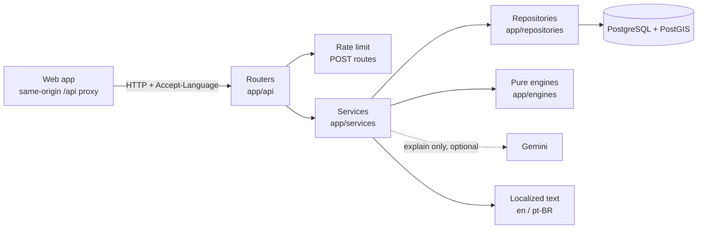
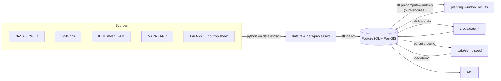

# Backend architecture

How the backend answers a request, how the data gets there, and why it is built this way. Endpoints, settings and errors are in [../backend/README.md](../backend/README.md); the data tooling is in [../data/README.md](../data/README.md).

## Request flow

A recommendation request resolves the place (point in polygon, or the municipality code), applies defaults for soil class and regime, reads the precomputed 36-dekad curve of each crop for the municipality's climate cell, attaches the ZARC window and PAM yields, applies the quality gate for that place, ranks, and writes the explanatory text. Nothing is simulated or fetched from an external service while the request is open.

## Data flow

## Key decisions

- **Engines are pure.** `app/engines/` is numpy only: no database, no network, no clock. The same functions run in the API, the ETL and the tests, and are tested against the FAO-56 bulletin (Example 18 for ET0) and against properties of the water balance.
- **Precompute, do not simulate per request.** The simulation covers every climate cell, crop and soil class over 40 seasons, so a request reads 36 rows per crop. Responses are fast and deterministic, and no external service can fail a request. Only rainfed is simulated.
- **Climate per cell, not per point.** POWER is a 0.5 by 0.625 degree grid, so every point in a cell shares one series. The cell is queried at its centre and the user's coordinate is never sent to a data service. `near_centroid` tells the user when their point is in another cell than the municipality's centroid.
- **Method.** ET0 by FAO-56 Penman-Monteith from POWER daily data; Kc by stage (midpoint of published ranges, linear transitions); root depth growing from 0.15 m at planting to the lower published maximum over stages 1 and 2; the FAO-56 daily root-zone balance (TAW, RAW, Ks). A season succeeds when ETa/ETc is at least 0.80 and the flowering-stage deficit is under 25 mm. The success frequency over the valid seasons, with a Wilson 95% band, is the reported `p`: a historical frequency, not a calibrated probability. The planting date of a dekad is its first day, and dekad 1 is assumed to be Jan 1-10.
- **Soil assumptions are explicit.** Available water is 0.08, 0.11 and 0.14 m3/m3 for soil classes 1, 2 and 3 (0.11 is the proposal's premise; the other two are project assumptions), starting at 60% moisture, effective rain equal to rain, no irrigation. They are listed in `missing_data` of every ranked crop and in `crop_parameter_sources`.
- **The quality gate is local.** The engine is checked against ZARC where the answer is shown: a crop is ranked at a place only if the Spearman correlation between its 36 simulated frequencies and ZARC's recommended dekads there is at least 0.7 (`gate_failed` otherwise, `engine_not_run` without ZARC). A single statewide number would hide places where a crop agrees with ZARC and places where it does not. The statewide median per crop (`validate gate`) is still stored and served as information: peanut 0.85, sorghum 0.81, sunflower 0.75 and cotton 0.74 pass; cowpea 0.53, maize 0.64 and castor -0.09 fail statewide, while cowpea passes locally at the pilot municipality (0.83). Agreement with ZARC is not independent validation, because ZARC is derived from a water balance.
- **Irrigated is excluded, not faked.** With irrigation the success rule is vacuous (ETa equals ETc), so the irrigated regime returns every crop in `excluded` with `no_data_for_regime` instead of a misleading curve.
- **Decodable, coordinate-free analysis id.** `csa_<method>_<code>.<soil>.<u|d>.<r|i>.<u|d>.<p|m>.<0|1>` carries everything that defines an analysis except the point, so `GET /recommendations/{id}` and `/explain` recompute it without storing anything, and no coordinate reaches URLs, logs or responses. The method version is part of the id, so ids from another method are rejected as unknown.
- **One error envelope, localized, no echo.** Every failure uses the contract envelope in `en` or `pt-BR`; validation errors never repeat the offending values, and only method, path, status and duration are logged.
- **Gemini only rewrites.** It receives the finished, coordinate-free recommendation and may not compute or choose. The answer is accepted only if it validates and every percentage can be derived from the payload; otherwise, and on any failure or without a key, the deterministic template is returned. Accepted answers are cached per (id, language).
- **Contract first.** The schemas in `contract/` are generated from the web's zod schemas, and the contract tests validate the backend's responses against them. Where the original plan and the contract differ, the contract wins.
- **ML is a seam.** `app/engines/calibration/` defines the `Calibrator` interface and an identity implementation; `flags.ml_applied` stays `false` until a model is trained ([plan](../data/ml/README.md)).

## Limits

- The in-process rate limiter and the explanation cache are per process, so run one worker, or limit at a proxy.
- Results are only as good as the inputs: 50 km gridded rain, modeled soil at a centroid, FAO-56 reference parameters. See [data-sources.md](data-sources.md).
