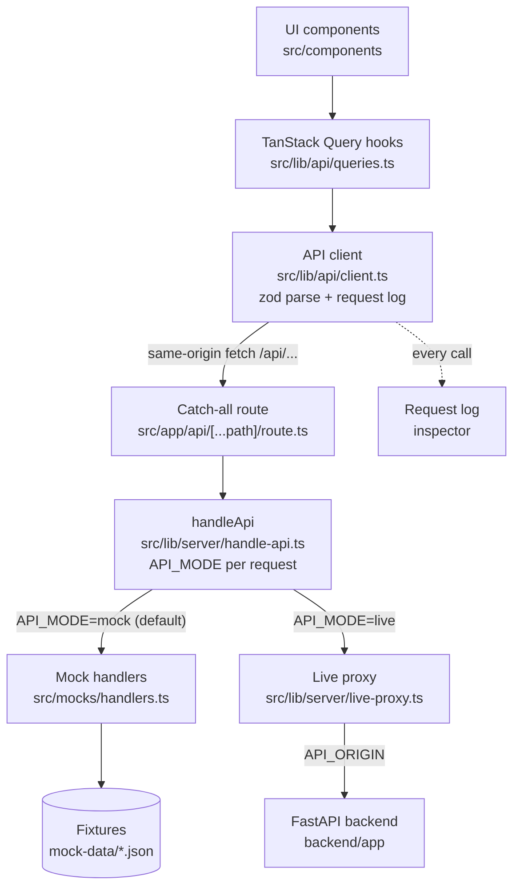

# Data flow

How a request travels from the UI to the data, which layer is mocked, and where each fixture comes from. For running the app see [../README.md](../README.md); for the API shapes see [../../contract/README.md](../../contract/README.md).

## Request flow

1. Components never call `fetch`. They use the hooks in `src/lib/api/queries.ts` (`useHealth`, `useCrops`, `useResolve`, `useRecommendation`, `useExplanation`).
2. The hooks call `api.*` in `src/lib/api/client.ts`. The client parses every response with the zod schema from `src/contract/schemas.ts`; a body that does not match becomes an `ApiClientError` with code `schema_mismatch`. Error bodies are parsed as the contract error envelope. Each call is recorded in the in-memory request log (last 50) that feeds the [inspector](../README.md#data-flow-inspector). In mock mode the client adds the `x-mock-scenario` header when a scenario is selected.
3. All calls are same-origin `/api/...`: one catch-all route, no CORS, and any backend secret stays server-side.
4. `handleApi` reads `API_MODE` on each request and sets `x-cropshift-mode` and `cache-control: no-store` on the response.
5. In mock mode `src/mocks/handlers.ts` routes the request, builds the answer from the fixtures and validates its own output against the contract (a mock that drifts returns 500 `internal`). In live mode `live-proxy.ts` forwards to `API_ORIGIN`.

What is mocked: only the layers below `/api`. The client, zod validation, query cache, UI and the `/api` route itself are the real code in both modes. The inspector draws this boundary.

Live proxy behavior (`src/lib/server/live-proxy.ts`):

- Forwards only `content-type`, `accept`, `accept-language` and `x-request-id`, plus the client IP as `x-forwarded-for` (from the incoming `x-forwarded-for`, else `x-real-ip`).
- `/api/health` goes to `/health`; every other path goes to `/api/<path>` with its query string.
- Successful responses pass through. Error bodies that already match the contract envelope pass through. Anything else is normalized: unreachable or timeout gives 503 `upstream_unavailable`; 400 or 422 gives `invalid_request`; 429 gives `rate_limited`; other 5xx gives 503 `upstream_unavailable`; remaining statuses give `internal`. Missing `API_ORIGIN` gives 503 `upstream_unavailable`.

## Language

The locale lives in a client store (`src/i18n/store.ts`, persisted as `cropshift-lang`). The query hooks read it, put it in the query key and pass it to `api.*`, which sends it as `Accept-Language`. In mock mode `src/mocks/handlers.ts` picks the language from that header (English for anything else), localizes the text via `src/mocks/messages.ts` and sets `Content-Language`. In live mode `live-proxy.ts` forwards `accept-language` and passes the backend's `content-language` back. Error copy is chosen on the client per error code. Ids and numbers are the same in every language.

## Fixtures: real vs synthetic

All fixtures are in `web/mock-data/` and committed. `src/mocks/data.ts` loads them.

| Fixture | Content | Origin |
| --- | --- | --- |
| `zarc.json` | ZARC risk table, 36 values per municipality, crop and soil | Real. MAPA ZARC, season 2025/26, CC BY. Built by `npm run gen:fixtures -- --zarc <csv>`. |
| `pam.json` | Yield (kg/ha) per municipality and crop, 2005-2024, plus state medians | Real. IBGE PAM. Built by `npm run gen:fixtures -- --pam <csv>`. |
| `requirements.json` | Raw FAO-56 and EcoCrop requirements per crop (served as `Crop.requirements`, shown in the crop detail sheet) | Real. FAO-56 (Allen et al. 1998) and FAO EcoCrop, from the team's crop sheet CSV. Built by `npm run gen:fixtures -- --ficha <csv>`. |
| `municipalities.json`, `public/geo/pe-municipalities.json` | 185 municipalities: code, name, centroid, POWER cell; map polygons | Real. IBGE malhas v3 (`qualidade=minima`) and localidades API. Built by `npm run gen:geo`. The POWER cell id is derived from the centroid by `src/lib/domain/geo.ts`. |
| `prototype.json` | Cowpea `p_success` for São Bento do Una (2613008), soil 2, rainfed, 40 seasons | Digitized from the proposal chart (page 8), not exported numbers. Plus per-crop summaries used to shape other curves. |
| `catalog.json` | Crop list, cycle length, PAM crop name, quality-gate status per crop, `method_version`, `data_version` | Hand-written from the plan; placeholder for track C's gate report. |
| everything else | `p_success` for every other crop, municipality, soil and regime | Synthetic. |

Synthetic curves (`src/mocks/synth.ts`) are deterministic: a seeded PRNG (mulberry32) keyed by municipality, crop, soil and regime, shaped around the ZARC window (or around the rainfed medium-soil window when there is no ZARC), snapped to whole seasons out of 40. The `lo`/`hi` band is the Wilson 95% interval with n = 40 seasons. At São Bento do Una (rainfed) cowpea uses the digitized values scaled for soil class; peanut, sorghum and castor are synthetic curves shaped by the prototype summaries. Every recommendation lists its sources, and synthetic curves are tagged `mock-synthetic`. Responses carry `mock: true`, and the `mock` disclaimer says the probabilities are synthetic while ZARC and PAM are real.

Rules that are also mock behavior, not real engine output:

- Gate: only crops with `gate.status = passed` in `catalog.json` are ranked (`crops[]`); others go to `excluded[]` with `reason_code` `gate_failed` or `engine_not_run`. Threshold: 0.7 (Spearman against ZARC).
- Ranking score: highest mean `p` over 3 consecutive dekads (wrapping). `best_windows`: up to two runs with `p >= 0.7`, or the best 3-dekad run if none reaches it.
- Confidence (`src/mocks/confidence.ts`): high when the best dekad is in ZARC's best class and the point is near the municipality centroid; medium when it is inside the ZARC window but not the best class, or the point is in another climate cell; low when ZARC is missing or the best dekad is outside it.

## ZARC and PAM mapping

`build-mock-fixtures.ts` and `src/mocks/data.ts` apply these rules:

- ZARC: rainfed rows ("Sequeiro") only. Soil classes 1-3 only (texture classes). When a municipality, crop and soil have several rows, cycle 21 is preferred, then the lowest cycle, then the general climate over a regional variant. `cycle_code`, `ordinance`, `soil_code` and `season` travel with the values.
- Values 0, 20, 30 and 40 are shown as-is. Their meaning as risk percent is not confirmed.
- Common bean has only AD soil classes (11-16) in rainfed ZARC, so there is no mapping from soil 1-3: `zarc` is `null` and `missing_data` says so.
- Irrigated regime: `zarc` is `null` for every crop (irrigated ZARC uses AD classes), and curves are synthetic.
- PAM: crops `feijao`, `milho`, `sorgo`, `amendoim`, `mamona`. PAM `feijao` pools all beans, so cowpea and common bean both use it (`pam.crop_label = "feijao"`). Sunflower has no PAM (`pam: null`, `has_pam: false`).
- Dekad 1 is assumed to be Jan 1-10.

## Swap the mock for the real API

1. Run the FastAPI backend implementing [the contract](../../contract/README.md) (`make stack`, or `make run`; see [the backend README](../../backend/README.md)).
2. Start the web with `API_MODE=live` and `API_ORIGIN=<backend origin>` (see [the env table](../README.md#environment-variables)). No rebuild.
3. Check `GET /api/health` returns the backend's `/health` payload with `mock: false`.

Nothing in the UI changes: it only depends on the contract. The UI shows the mock banner and inspector only when a response says `mock: true` (or with `?debug=1`); `SHOW_DATA_FLOW=false` hides the inspector in every mode.

`mock-data/catalog.json` is the gate config in mock mode: the web reads only that file for crop gate status. Its `_note` says to replace it with track C's gate report. In live mode the same information comes from `GET /api/v1/crops` and from `crops[]` / `excluded[]` in each recommendation, so the file is unused.

## Privacy

- Coordinates never appear in the page URL. The URL holds only `mun` (municipality code), `soil`, `regime` and `crop`. An exact point lives in memory only, so it does not end up in links, history or server logs.
- The recommendation request does need `lat`/`lon` (in the POST body) to resolve the point to a municipality and POWER cell. The analysis JSON (`Recommendation`) carries only `municipality_code`, the POWER cell and options, never the coordinates. The mock `analysis_id` encodes only those, never coordinates.
- The live proxy forwards only the headers listed above, with the client IP in `x-forwarded-for` for rate limiting.
- `gen:geo` makes anonymous requests to public IBGE APIs and sends no user data.
